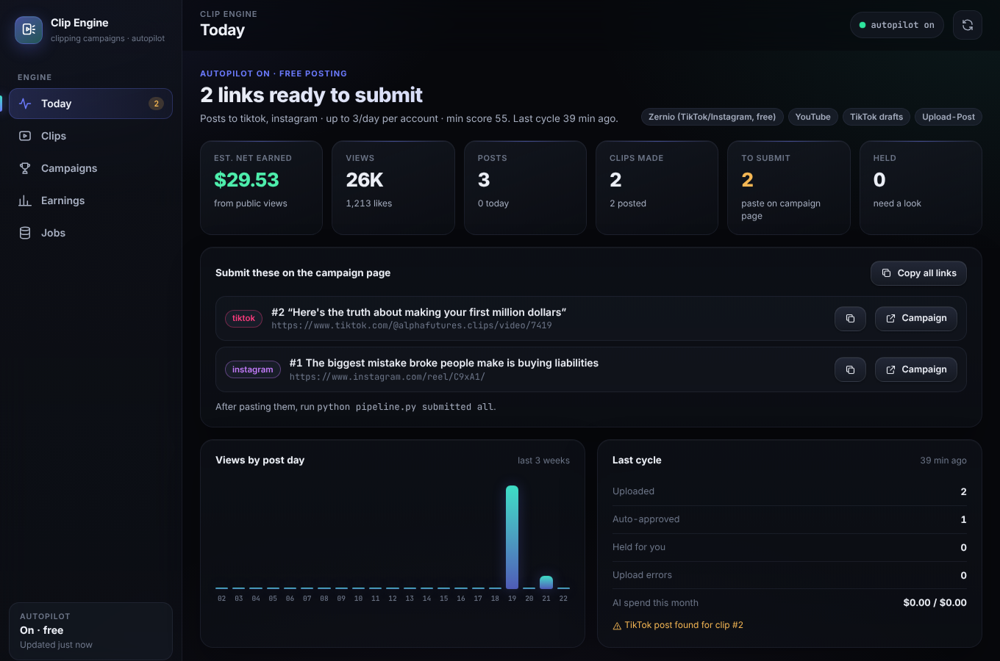

# Start here

Everything is built: clipping, captions, logo overlay, `#ad`, rule checks,
free automatic posting to TikTok (and Instagram/YouTube), view tracking, a
dashboard and a schedule every 6 hours.

## The one rule that decides where we clip

Many campaigns ban **automated or AI clipping tools**, and this tool is one.
Clips that break a rule aren't paid. Alpha Futures and Alpha Capital Group
both ban it, so we skip them. The autopilot refuses any campaign until you
confirm its rules allow tools.

**How to check a campaign (1 minute):** open its rules page and press
**Ctrl+F** (Cmd+F on Mac). Search for **AI**, **automat**, **tool** and
**repurpos**. If nothing forbids tools, it's a go.

## Your steps

**1. Pick a campaign** on Whop → Content Rewards that pays on TikTok and
passes the check above, then join it. Trading and finance creators are a
good fit. Check that it has budget left.

**2. TikTok:** make the account the campaign asks for. Most want a dedicated
account with the creator's or brand's name in it.

**3. Zernio (free):**
- Sign up at **zernio.com**.
- Connect that TikTok account.
- Create an **API key**.

**4. Download this tool:**
- Get the
  [ZIP](https://github.com/demetrades2000-coder/nq-dashboard/archive/refs/heads/claude/determined-shannon-94kfrp.zip)
  and unzip it.
- Install **Python** from [python.org](https://www.python.org/downloads/).
  On Windows, tick **"Add python.exe to PATH"**.

**5. Double-click `START.bat`** (Windows) or **`START.command`** (Mac),
inside the `clipper` folder. It installs everything and asks plain
questions:
- **"Add a new campaign you joined?"** Yes. Answer with its name, link, pay
  rate, platforms and the @handle to tag. When folders open, drop in the
  footage (and logo, if the rules require one).
- **"Do the rules allow automated / AI clipping tools?"** Answer honestly
  from your Ctrl+F check.
- **"Post automatically for free?"** Yes. Paste the Zernio key.
- **TikTok consent, schedule, first run:** yes.

## Ongoing (2 minutes, every day or two)

1. Open `AUTOPILOT_REPORT.md` (in the `clipper-workspace` folder).
2. Paste the new links into the campaign's submit form on Whop.
3. Run `python pipeline.py submitted all` to mark them done.

The dashboard below shows the same links, each with a copy button.

When the brand posts new footage, drop it into the same footage folder.

## Your dashboard

Double-click **`DASHBOARD.bat`** (Windows) or **`DASHBOARD.command`** (Mac).
It's the same style as the NQ dashboard:
- **Today:** earnings, views, links to submit (one-click copy) and anything
  held.
- **Clips:** every clip and where it's posted.
- **Campaigns:** rates, rule status, results.
- **Earnings:** by platform, campaign and top posts.
- **Jobs:** what the engine did.

It refreshes itself after every autopilot cycle.

## If something looks wrong

Run `python pipeline.py doctor`. It tells you exactly what to fix.
