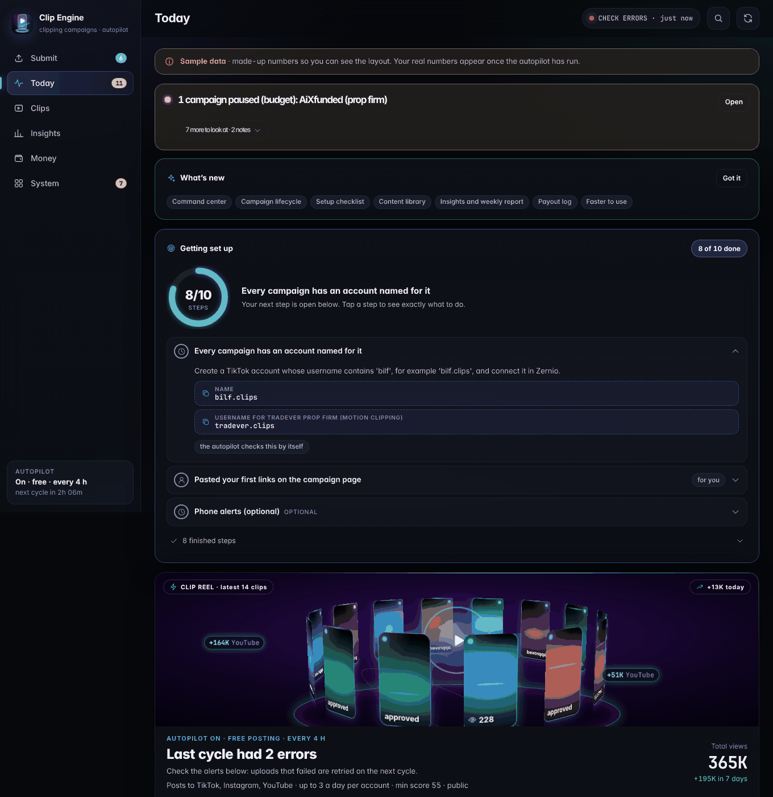
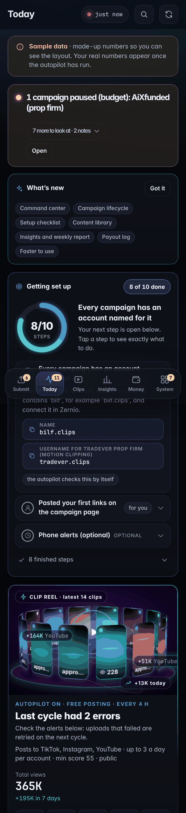

# Start here

Everything is built: clipping, captions, logo overlay, `#ad`, rule checks, free automatic posting to TikTok, view tracking, a
dashboard, phone notes. It runs by itself in the cloud, so your PC can stay off.

New to this? Read **[OWNER_GUIDE.md](OWNER_GUIDE.md)** (plain English, phone first) and **[FAQ.md](FAQ.md)** (the honest answers about
earnings and payouts). The engineer's manual is [RUNBOOK.md](RUNBOOK.md).

## Running now: in the cloud, PC off, free

The autopilot runs on **GitHub Actions** (workflow `clipper-cloud`) about every 4 hours. That is free on this public repo and needs no PC
and no Claude usage. Each run:

1. checks every campaign's live page on Content Rewards (budget left, still open) and pauses a campaign that has run dry;
2. picks up new footage from the campaign's shared Google Drive folder;
3. cuts clips and slideshows, adds captions, logo and `#ad`;
4. posts them to TikTok through Zernio, between 08:00 and 22:59 New York time, each clip to **one** page whose name contains the brand;
5. counts views and rebuilds the dashboard;
6. sends a phone note only if something needs you (optional, needs the `NTFY_TOPIC` secret).

Your dashboard (add it to your Home Screen):
**https://raw.githack.com/demetrades2000-coder/nq-dashboard/clipper-cloud/site/index.html**

What it needs from you, once:
1. TikTok pages with the brand in the name (for example `tradever.clips`).
2. A Zernio account (its free plan covers 2 pages): connect the pages and create an API key.
3. Add the key as a GitHub secret named **`ZERNIO_API_KEY`**:
   https://github.com/demetrades2000-coder/nq-dashboard/settings/secrets/actions/new
   (Optional: a second secret `NTFY_TOPIC`, a long random word, for phone notes. Install the free ntfy app and subscribe to it.)
4. Join each campaign on Content Rewards, read its Rules tab, and send Claude the link and the rules.

Stop: Actions, `clipper-cloud`, Disable workflow. Restart: Run workflow on branch `claude/determined-shannon-94kfrp`.
Do not edit the workflow file while it is live: saving it restarts the chain.

### Your ongoing chore (about 2 minutes a day)

Content Rewards has no way for a robot to submit your links, so you do that part:

1. Open the dashboard and tap **Submit**.
2. Tap **Copy next link**, paste it into the campaign's submit box on Content Rewards, and repeat until it says all submitted.

The ticks are kept in that browser only. On the PC version you can also run `python pipeline.py submitted all`.

If something looks wrong, the traffic light at the top of **Today** says what and what to do. More in the owner guide.

## The one rule that decides where we clip

Many campaigns ban **automated or AI clipping tools**, and this tool is one. Clips that break a rule aren't paid. Alpha Futures and
Alpha Capital Group both ban it, so we skip them. The autopilot refuses any campaign until its brief records that the rules allow tools.

**How to check a campaign (1 minute):** open its Rules tab and use Find on page (Ctrl+F, or Cmd+F on a Mac). Search for **AI**, **automat**,
**tool** and **repurpos**. If nothing forbids tools, it's a go. (Rules only show after you join, which is free.)

## Honest note on money

The dollar amounts on the dashboard are **estimates** (public views times the campaign rate, minus the fee). Content Rewards pays on the
views it verifies, about 10 days after (a 7-day earning period then a 3-day hold), and has rules and checks we cannot see. Early posts often earn
$0 because of campaign minimums. See [FAQ.md](FAQ.md).

## Optional: the same tool on your own computer

Use this for other campaigns or if you prefer it. It does not need the cloud.

**1. Pick a campaign** on Whop, Content Rewards that pays on TikTok and passes the check above, then join it. Trading and finance
creators are a good fit. Check that it has budget left.

**2. TikTok:** make the account the campaign asks for. Most want a dedicated account with the creator's or brand's name in it.

**3. Zernio (free):** sign up at **zernio.com**, connect that TikTok account, create an **API key**.

**4. Download this tool:**
- Get the
  [ZIP](https://github.com/demetrades2000-coder/nq-dashboard/archive/refs/heads/claude/determined-shannon-94kfrp.zip)
  and unzip it.
- Install **Python** from [python.org](https://www.python.org/downloads/). On Windows, tick **"Add python.exe to PATH"**.

**5. Double-click `START.bat`** (Windows) or **`START.command`** (Mac), inside the `clipper` folder. It installs everything and asks
plain questions:
- **"Add a new campaign you joined?"** Yes. Answer with its name, link, pay rate, platforms and the @handle to tag. When folders
  open, drop in the footage (and logo, if the rules require one).
- **"Do the rules allow automated / AI clipping tools"** Answer honestly from your check.
- **"Post automatically for free?"** Yes. Paste the Zernio key.
- **TikTok consent, schedule, first run:** yes.

On the PC, every cycle writes `AUTOPILOT_REPORT.md` (in the `clipper-workspace` folder) listing the links to submit. Paste them into the
campaign's submit form, then run `python pipeline.py submitted all` to mark them done.

### The PC dashboard

Double-click **`DASHBOARD.bat`** (Windows) or **`DASHBOARD.command`** (Mac). Same style as the NQ dashboard:
- **Today:** the traffic light, links to submit (one-click copy), anything held.
- **Clips:** every clip and where it's posted.
- **Campaigns:** rates, rule status, results, leads.
- **Earnings:** estimates by platform, campaign and top posts.
- **Jobs:** what the engine did.

It refreshes itself after every autopilot cycle.

**On your phone, as its own app** (PC version only; the cloud dashboard above already works as a Home Screen app): setup asks "Put your
dashboard on your phone as its own app?" Type **y**. GitHub's token page opens: set Expiration to **No expiration**, click **Generate
token**, copy it and paste it into the window. The clipper then makes its own site (the `clip-engine` repo with GitHub Pages) and publishes
to it after every cycle. Open `https://demetrades2000-coder.github.io/clip-engine/` on your iPhone in Safari, Share, Add to Home Screen.
It's public; use `python pipeline.py publish setup --hide-money` if you don't want earnings visible. The token is kept in your PC's
password store.

## If something looks wrong

On the PC: run `python pipeline.py doctor`; it tells you exactly what to fix. In the cloud: read the traffic light on **Today**, then
"When something goes wrong" in [OWNER_GUIDE.md](OWNER_GUIDE.md). Engineers: [RUNBOOK.md](RUNBOOK.md).
